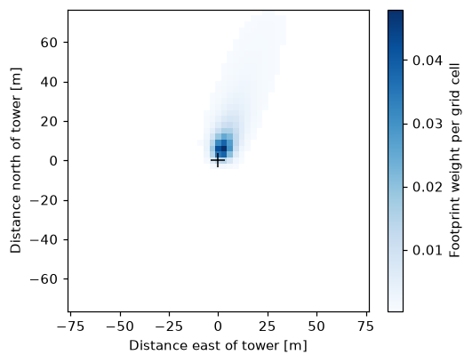

Getting started
===============

The main functions are imported from the package:

* ``ffp_climatology``, the `Kljun et al. (2015) <https://gmd.copernicus.org/articles/8/3695/2015/>`_ flux footprint prediction (FFP) model
* ``mask_fp_cutoff``, keeps the part of a footprint that makes up a set fraction (default 90%) of the source area
* ``find_transform``, the affine transform used to write a footprint grid to a georeferenced GeoTIFF
* ``get_nldas2_data``, downloads hourly NLDAS-2 forcing data for a point from NASA Giovanni

A footprint for one half hour
-----------------------------

The inputs are for one half hour at the Celery example site:

.. code-block:: python

    import numpy as np
    from fluxfootprint import ffp_climatology, mask_fp_cutoff

    dx = 3.0  # grid resolution [m]
    fp = ffp_climatology(
        zm=1.24,         # measurement height minus displacement height [m]
        z0=0.015,        # roughness length [m]
        umean=None,
        h=2000.0,        # boundary layer height [m]
        ol=213.0,        # Obukhov length [m]
        sigmav=0.60,     # standard deviation of lateral wind speed [m s-1]
        ustar=0.35,      # friction velocity [m s-1]
        wind_dir=19.8,   # wind direction [degrees from north]
        domain=[-75, 75, -75, 75], dx=dx, dy=dx, rs=None, fig=False, verbosity=0,
    )
    f_2d = np.array(fp['fclim_2d']) * dx**2  # footprint weight per grid cell
    f_2d = mask_fp_cutoff(f_2d, cutoff=0.9)  # keep the 90% source area

    print(list(fp.keys()))
    print(f_2d.shape, round(f_2d.sum(), 3))

Output:

.. code-block:: text

    ['x_2d', 'y_2d', 'fclim_2d', 'n', 'flag_err']
    (51, 51) 0.9

``fp`` is a dictionary. ``fp['fclim_2d']`` is the footprint [m-2] on the grid given by ``fp['x_2d']`` and ``fp['y_2d']``, the distances from the tower [m]. Multiplying by the grid cell area gives the weight of each cell, which sums to about 1 over the whole footprint. After the 90% cutoff the weights sum to 0.9.

To plot it:

.. code-block:: python

    import matplotlib.pyplot as plt

    x_2d, y_2d = np.array(fp['x_2d']), np.array(fp['y_2d'])
    fig, ax = plt.subplots(figsize=(5, 4))
    mesh = ax.pcolormesh(x_2d, y_2d, np.ma.masked_equal(f_2d, 0), cmap='Blues')
    ax.plot(0, 0, 'k+', ms=10)  # tower
    ax.set_aspect('equal')
    ax.set_xlabel('Distance east of tower [m]')
    ax.set_ylabel('Distance north of tower [m]')
    fig.colorbar(mesh, label='Footprint weight per grid cell')
    plt.show()

The wind came from 19.8 degrees (north-northeast), so the footprint lies upwind of the tower.

Write a georeferenced raster
----------------------------

To place the footprint on a map, add the tower's projected coordinates to the grid and use ``find_transform`` to get the transform for rasterio. The Celery tower is in UTM zone 10N:

.. code-block:: python

    import rasterio
    from pyproj import Transformer
    from fluxfootprint import find_transform

    # tower location in UTM zone 10N (EPSG:32610)
    to_utm = Transformer.from_crs('EPSG:4326', 'EPSG:32610', always_xy=True)
    tower_x, tower_y = to_utm.transform(-121.373706, 36.438847)

    transform = find_transform(x_2d + tower_x, y_2d + tower_y)
    with rasterio.open(
            'footprint.tif', 'w', driver='GTiff', dtype='float64', count=1,
            height=f_2d.shape[0], width=f_2d.shape[1], crs='EPSG:32610',
            transform=transform, nodata=0) as dst:
        dst.write(f_2d, 1)

    with rasterio.open('footprint.tif') as src:
        print(src.crs, src.res, src.shape)

Output:

.. code-block:: text

    EPSG:32610 (3.0, 3.0) (51, 51)

Several time steps and input checks
-----------------------------------

Lists with one value per time step give a footprint climatology, the average of the footprints of all valid time steps:

.. code-block:: python

    fp = ffp_climatology(
        zm=1.24, z0=0.015, umean=None,
        h=[2000.0, 2000.0, 2000.0],
        ol=[213.0, -50.0, -20.0],
        sigmav=[0.60, 0.58, 0.65],
        ustar=[0.35, 0.32, 0.30],
        wind_dir=[19.8, 25.0, 30.0],
        domain=[-75, 75, -75, 75], dx=dx, dy=dx, rs=None, fig=False, verbosity=0,
    )
    print(fp['n'], 'valid time steps')

Output:

.. code-block:: text

    3 valid time steps

Numpy arrays or pandas Series with more than one value are not accepted, convert them with ``.tolist()``.

As in Kljun's FFP code, time steps outside the range where the model is valid get no footprint. This includes a friction velocity of 0.1 m s-1 or less, zm/L of -15.5 or less (very unstable), a standard deviation of lateral wind speed of 0 or less, and a wind direction outside 0 to 360 degrees, along with checks on the measurement and boundary layer heights. If no time step is valid, ``fp['flag_err']`` is 1 and the footprint is all zeros:

.. code-block:: python

    fp = ffp_climatology(
        zm=1.24, z0=0.015, umean=None, h=2000.0, ol=213.0, sigmav=0.60,
        ustar=0.05,  # too little turbulence
        wind_dir=19.8,
        domain=[-75, 75, -75, 75], dx=dx, dy=dx, rs=None, fig=False, verbosity=0,
    )
    print(fp['flag_err'], fp['n'], np.sum(fp['fclim_2d']))

Output:

.. code-block:: text

    No footprint calculated
    1 0 0.0

Examples
--------

The example Jupyter notebooks are in the ``example notebooks`` folder of the repository:

* ``celery_site/celery.ipynb`` is the simplest place to start. It shows the input data the footprint model needs and makes half-hourly footprints centered on the tower.
* ``using_fluxdataqaqc_with_AMF/example with flux-data-qaqc.ipynb`` prepares AmeriFlux data with flux-data-qaqc and writes a georeferenced (UTM) GeoTIFF with one band per hour for a day.

The notebooks ``scripts/Run_AMF_Daily.ipynb`` and ``scripts/Run_AMF_Monthly.ipynb`` document the workflow used for OpenET to make daily and monthly footprints weighted by hourly NLDAS-2 ASCE short reference ET.
