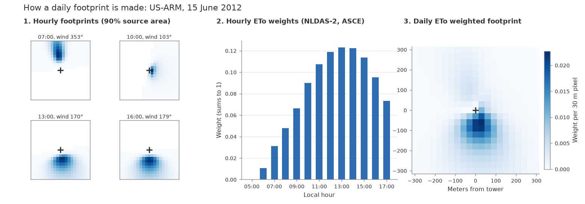

flux-data-footprint
===================

Daily and monthly flux footprint rasters for eddy covariance towers using the `Kljun et al. (2015) <https://gmd.copernicus.org/articles/8/3695/2015/>`_ two-dimensional flux footprint model, with hourly footprints weighted by NLDAS-2 ASCE short reference ET (ETo).

   Hourly footprints are weighted by hourly NLDAS-2 ASCE short reference ET (ETo) and summed into a daily footprint on a 30 m grid aligned with Landsat (AmeriFlux site US-ARM).

.. note::

   This documentation is under development. For installation and getting started see the `README on GitHub <https://github.com/Open-ET/flux-data-footprint>`_.
